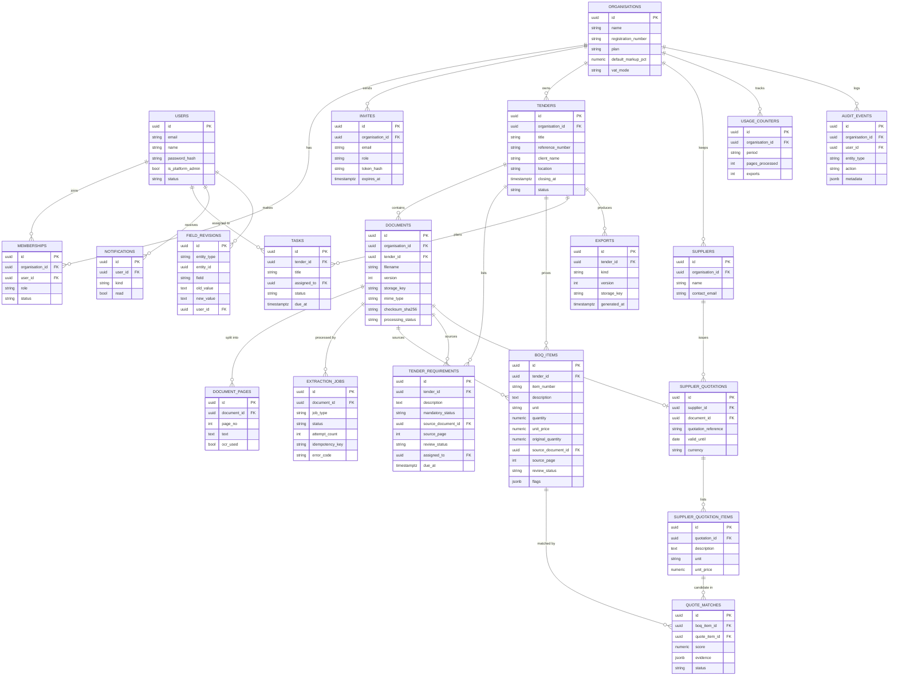

# IntelTPS detailed architecture

See `CLAUDE.md` for the rules. Visual version: `visuals/inteltps-architecture.html`.

## Modules

| Module | Runs in | Does | Endpoints | Tables |
| --- | --- | --- | --- | --- |
| Auth and members (`auth`) | Backend API | Sign-up, login, invites, roles and deactivation. Issues the JWT the rest of the system trusts. | `POST /auth/register` `POST /auth/login` `POST /auth/logout` `GET /me` `POST /invites` `PATCH /members/{id}` | users, organisations, memberships, invites |
| Tenant core (`core`) | Backend API | OrgScopedRepository base class: every query is filtered by the organisation in the token. Also config, error format and the audit hook. | `(no endpoints; used by every module)` | every organisation-owned table |
| Tenders (`tenders`) | Backend API | Tender workspaces: details, closing dates, stage, archive, and the dashboard of upcoming deadlines. | `POST /tenders` `GET /tenders` `GET /tenders/{id}` `PATCH /tenders/{id}` `POST /tenders/{id}/archive` `GET /dashboard` | tenders |
| Documents (`documents`) | Backend API | Validates uploads by their bytes, stores them in Blob with a checksum and version, queues processing and hands out short-lived download links. | `POST /tenders/{id}/documents` `GET /documents/{id}` `GET /documents/{id}/download` `POST /documents/{id}/process` | documents, document_pages |
| Jobs (`jobs`) | Backend API | Job status for the UI and manual retry. The worker updates the same rows. | `GET /jobs/{id}` `POST /jobs/{id}/retry` | extraction_jobs |
| Checklist and tasks (`checklist`) | Backend API | Tender requirements with source references, classification, approval, assignment and task tracking. | `GET /tenders/{id}/requirements` `PATCH /requirements/{id}` `GET /tenders/{id}/checklist` `POST /tasks` `PATCH /tasks/{id}` | tender_requirements, tasks |
| BoQ and estimating (`boq`) | Backend API | Editable BoQ lines that keep their original values, material, labour and markup, Decimal totals and flags for missing or odd values. | `GET /tenders/{id}/boq` `PATCH /boq-items/{id}` `POST /tenders/{id}/boq/approve` | boq_items, field_revisions |
| Suppliers and quotes (`suppliers`) | Backend API | Supplier records, quote import, match suggestions with evidence (text, unit, spec, price, validity) and human confirmation. | `POST /suppliers` `GET /suppliers` `POST /quotations` `GET /tenders/{id}/comparisons` `PATCH /matches/{id}` | suppliers, supplier_quotations, supplier_quotation_items, quote_matches |
| Exports and reports (`exports`) | Backend API | Excel of approved BoQ lines and a checklist PDF, stamped with version, date, sources and a draft or approved label. | `POST /tenders/{id}/exports` `GET /exports/{id}/download` | exports |
| Audit (`audit`) | Backend API | Records who changed what and when, without storing document text. | `GET /audit` | audit_events |
| Plans and usage (`usage`) | Backend API | Plan limits, page counters and feature gates, checked before any processing is queued. | `GET /usage` | usage_counters, organisations |
| Notifications (`notifications`) | Backend API | In-app reminders for approaching deadlines and assigned tasks; email later if configured. | `GET /notifications` `PATCH /notifications/{id}` | notifications |
| File extractors (`processing`) | Extraction worker | Turns each file type into page text and tables with page or sheet references. No AI here. | — | document_pages |
| AI extraction (`ai`) | AI services | Turns page text into schema-valid candidates for BoQ lines, requirements and quote lines. | — | boq_items, tender_requirements, supplier_quotation_items |

## Functional requirements traceability

| FR | Requirement | Module |
| --- | --- | --- |
| FR-01 | Register or join a business workspace | Auth and members |
| FR-02 | Authenticate users before protected access | Auth and members |
| FR-03 | Role-based access control | Auth and members |
| FR-04 | Invite, deactivate and manage users | Auth and members |
| FR-05 | Tenant isolation between businesses | Tenant core |
| FR-06 | Create tender workspace with title, reference, client, location, closing date, status | Tenders |
| FR-07 | Attach multiple documents to a tender | Documents |
| FR-08 | Update tender details and track processing stage | Tenders |
| FR-09 | Keep document versions and record which was analysed | Documents |
| FR-10 | Archive complete or abandoned tenders | Tenders |
| FR-11 | Support PDF, XLSX, CSV and DOCX | File extractors |
| FR-12 | Validate file type, size and upload permission | Documents |
| FR-13 | Extract embedded text | File extractors |
| FR-14 | OCR for scanned documents | File extractors |
| FR-15 | Record processing status, errors and timestamps | Jobs |
| FR-16 | Retry failed processing jobs | Jobs |
| FR-17 | Treat uploaded content as untrusted input | AI extraction |
| FR-18 | Extract deadlines, meetings, submission and eligibility requirements | AI extraction |
| FR-19 | Keep source document and page for each requirement | AI extraction |
| FR-20 | Edit, approve or reject extracted requirements | Checklist and tasks |
| FR-21 | Classify requirements as mandatory, conditional or informational | Checklist and tasks |
| FR-22 | Generate a checklist of requirements needing action | Checklist and tasks |
| FR-23 | Never present the checklist as an authoritative compliance ruling | Exports and reports |
| FR-24 | Extract BoQ line numbers, descriptions, units, quantities, prices | AI extraction |
| FR-25 | Edit extracted BoQ lines | BoQ and estimating |
| FR-26 | Keep original extracted values apart from corrections | BoQ and estimating |
| FR-27 | Material, labour and markup fields | BoQ and estimating |
| FR-28 | All financial calculations in deterministic code | BoQ and estimating |
| FR-29 | Flag missing quantities, units, prices and unusual values | BoQ and estimating |
| FR-30 | Produce a draft estimate without submitting it | Exports and reports |
| FR-31 | Create supplier records | Suppliers and quotes |
| FR-32 | Upload supplier quotations | Suppliers and quotes |
| FR-33 | Extract supplier names, items, quantities, units, prices, dates | AI extraction |
| FR-34 | Suggest matches between supplier items and BoQ lines | Suppliers and quotes |
| FR-35 | Users confirm or reject suggested matches | Suppliers and quotes |
| FR-36 | Show unit, specification, price and validity differences | Suppliers and quotes |
| FR-37 | Never select a supplier only because it is cheapest | Suppliers and quotes |
| FR-38 | Excel export of approved BoQ data | Exports and reports |
| FR-39 | Tender checklist report | Exports and reports |
| FR-40 | Source references and generation dates in reports | Exports and reports |
| FR-41 | Distinguish draft, reviewed and approved outputs | Exports and reports |
| FR-42 | Record export events in the audit trail | Audit |
| FR-43 | Assign requirements to team members | Checklist and tasks |
| FR-44 | Display approaching deadlines | Tenders |
| FR-45 | In-app reminders and optional email | Notifications |
| FR-46 | Update task statuses | Checklist and tasks |
| FR-47 | Record subscription status and plan limits | Plans and usage |
| FR-48 | Enforce configurable processing limits | Plans and usage |
| FR-49 | Prevent access to unpaid features | Plans and usage |
| FR-50 | Show usage information to the customer | Plans and usage |

## API role matrix (all under /api/v1)

| Endpoint | Admin | Estimator | Project manager | Reviewer |
| --- | --- | --- | --- | --- |
| POST /auth/register, /auth/login, /auth/logout | public | public | public | public |
| GET /me, /dashboard, /tenders, /documents/{id}, /jobs/{id}, requirements, boq, comparisons | yes | yes | yes | yes |
| POST /invites, PATCH /members/{id} | yes | no | no | no |
| GET, PATCH /organisation | edit | read | read | read |
| POST /tenders, PATCH /tenders/{id}, POST /tenders/{id}/documents | yes | yes | yes | no |
| POST /tenders/{id}/archive | yes | no | yes | no |
| POST /documents/{id}/process, POST /jobs/{id}/retry | yes | yes | no | no |
| PATCH /requirements/{id} | yes | yes | assign only | no |
| PATCH /boq-items/{id}, POST /tenders/{id}/boq/approve | yes | yes | no | no |
| POST, GET /suppliers | yes | yes | read | read |
| POST /quotations, PATCH /matches/{id} | yes | yes | no | no |
| POST, PATCH /tasks | yes | yes | yes | no |
| POST /tenders/{id}/exports | yes | yes | yes | no |
| GET /exports/{id}/download | yes | yes | yes | yes |
| GET /audit | yes | no | yes | read |
| GET /usage | yes | yes | yes | no |

## Data model

## Non-functional requirements

| Area | Requirement | Mechanism | Verified by |
| --- | --- | --- | --- |
| Performance | Upload confirmed within 5 s | API streams to Blob, writes one row, queues the job, returns 202 | Timed test, 10 MB PDF on staging |
| Performance | Async extraction with visible progress | Worker updates job status; UI polls every 3 s | Job status test |
| Performance | Excel export within 10 s | openpyxl write-only mode from approved rows | Timed test, 2,000 lines |
| Reliability | Recover from processing failures | 3 retries with backoff, then failed with error_code; original file untouched | Corrupt file, LLM timeout, bad JSON tests |
| Reliability | No duplicates on retry | Unique idempotency key; replace candidates in one transaction | Retry test: item count unchanged |
| Reliability | Logs without secrets or document text | Structured logs with ids only; filter strips tokens and text | Log scan in CI |
| Reliability | Backup and restore | Postgres automated backups and PITR; Blob soft delete | One restore drill, documented |
| Security | HTTPS and secure passwords | Azure-managed TLS; argon2id hashes | TLS check; hash unit test |
| Security | Backend authorisation and tenant isolation | Role dependencies; OrgScopedRepository on every query | Cross-tenant suite |
| Security | Restricted downloads | Private container; 5-minute SAS after permission check | Expired-link test |
| Security | Rate limiting | slowapi on login and upload | 429 test |
| Security | Dependency monitoring | Dependabot, pip-audit, npm audit | CI step |
| Privacy | POPIA purpose, retention, deletion, access | Privacy notice; org export and delete; 90-day retention after archive | Documented procedure + delete test |
| Privacy | Cross-border AI processing assessed | Minimum pages sent; provider region recorded | Written assessment |
| Usability | Office-level skills; clear states | Status badges, inline edit, plain errors | 3–5 pilot users |
| Usability | Mobile-responsive, keyboard accessible | Tailwind responsive layout; accessible components | Lighthouse score |
| Maintainability | Separated layers, tests, migrations | Router, service, repository per module; Alembic | Coverage report |
| Scalability | Modular monolith with a separate worker | One image, two entrypoints; worker scales on queue length | Scale rule on Container Apps |

## Business rules

| Rule | Enforced in | How |
| --- | --- | --- |
| BR-01 Extracted data unverified until approved | boq.service, checklist.service | Items start `extracted`; only `approve()` sets `approved`; exporters filter on approved |
| BR-02 Keep source provenance | ai.validators | `source_page` required; missing → flag `no_source`, cannot be approved |
| BR-03 Deterministic decimal maths | boq.pricing | Pure `Decimal` functions, ROUND_HALF_UP; LLM never returns totals |
| BR-04 No silent ambiguous matches | suppliers.matcher | Low score or unit/spec conflict stays `suggested`; only confirmed feeds prices |
| BR-05 Own data only | core.repository | `OrgScopedRepository` injects organisation_id from the token |
| BR-06 Check against current documents | documents.service | New version marks dependants `stale` |
| BR-07 No guarantee of compliance | exports, frontend | Fixed disclaimer; extracted vs verified shown separately |
| BR-08 No automatic bid submission | architecture | No submission integration exists |

## Document processing sequence

1. Browser `POST /tenders/{id}/documents` (multipart, JWT cookie)
2. Router checks role; DocumentService sniffs MIME, checks size and quota
3. Stream to Blob `org/{org}/tenders/{id}/{doc}/v{n}`, SHA-256 on the way
4. Insert `documents` (uploaded) + `extraction_jobs` (queued, idempotency key) in one transaction
5. Put `{job_id}` on the queue; return 202 with job id
6. Worker claims job (queued → running), skips if key already done
7. Extractor by MIME: sheets cell by cell, text PDFs via PyMuPDF/pdfplumber, scans via Document Intelligence; save `document_pages`
8. Page-chunked text to LLM with JSON schema; Pydantic validates
9. Validators add flags (missing unit, null vs zero, outliers, disqualifiers, low OCR confidence)
10. Replace this job's candidates, insert items as `extracted`; job → succeeded; usage + audit
11. UI poll sees succeeded, loads review screen (source page left, fields right)
12. Reviewer approves or corrects; `field_revisions` written; approved items feed totals and exports

On exception in 7–10: rollback, record `error_code`, retry up to 3 times.
